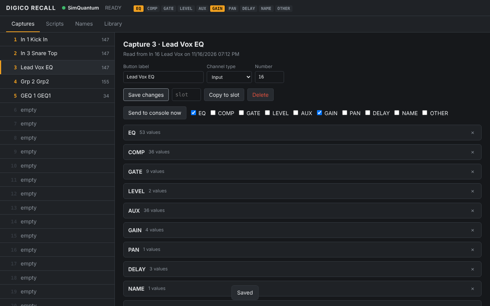

# companion-module-digico-recall

A [Bitfocus Companion](https://bitfocus.io/companion) module for DiGiCo SD and Quantum
consoles. Capture a whole channel with one button, put back only the parts you choose
(EQ, COMP, GATE, LEVEL, AUX, GAIN and more), chain recalls into scripts, save and restore
channel names, and browse or edit all of it in a web page.

See [HELP.md](./companion/HELP.md) for how to use it and [LICENSE](./LICENSE).



## Status

**0.1.x are test releases.** The logic is covered by 48 automated tests against a
simulated console. It has not yet been run against DiGiCo software or a console. The
address list comes from open-source observation of the iPad app and needs confirming on
each console. Progress is tracked in the [test log](docs/TESTING.md#3-test-log).

Needs Companion 4.3 or newer.

## Documents

|                                        |                                                                |
| -------------------------------------- | -------------------------------------------------------------- |
| [companion/HELP.md](companion/HELP.md) | Console setup, buttons, the web page                           |
| [CHANGELOG.md](CHANGELOG.md)           | What changed in each version                                   |
| [docs/TESTING.md](docs/TESTING.md)     | Automated tests, manual test plan, dated test log and findings |
| [docs/DESIGN.md](docs/DESIGN.md)       | How it works, why, and the development log                     |
| [RELEASING.md](RELEASING.md)           | Release and submission steps                                   |

## Trying a release

Download `digico-recall-<version>.tgz` from the
[releases page](https://github.com/jonathan-annett/companion-module-digico-recall/releases)
and load it in Companion with **Import module package** on the Connections page.

## Development

```
yarn install
yarn test                                      # automated tests against the simulated console
yarn preview                                   # web page at http://localhost:8088/instance/recall/, no console needed
node tools/probe.mjs 192.168.1.10 8001 8000    # list what a console answers, then print what it sends
yarn package                                   # build the .tgz
yarn format                                    # prettier
```

To run from source in Companion, set the developer modules path in the Companion launcher
to the folder that contains this repository.

If a console doesn't answer an address, or uses a different one, the fix goes in
[`src/params.js`](src/params.js). Please include the probe output with any report.

## Credits

The OSC address names follow the table in
[companion-module-digico-osc](https://github.com/bitfocus/companion-module-digico-osc)
by Andrew Broughton (MIT), which documents the DiGiCo iPad protocol. This module is not
affiliated with or endorsed by DiGiCo.
